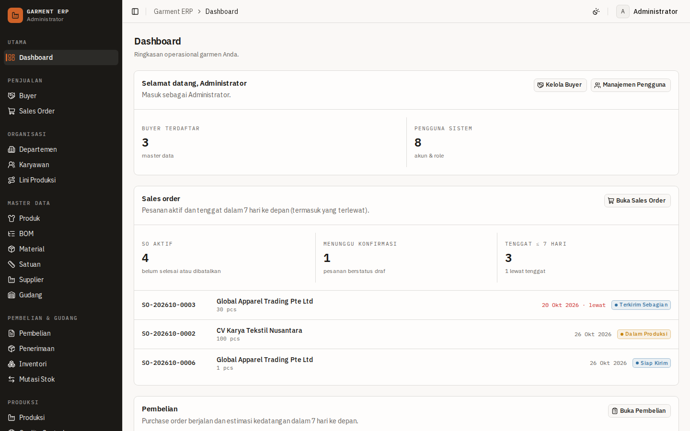
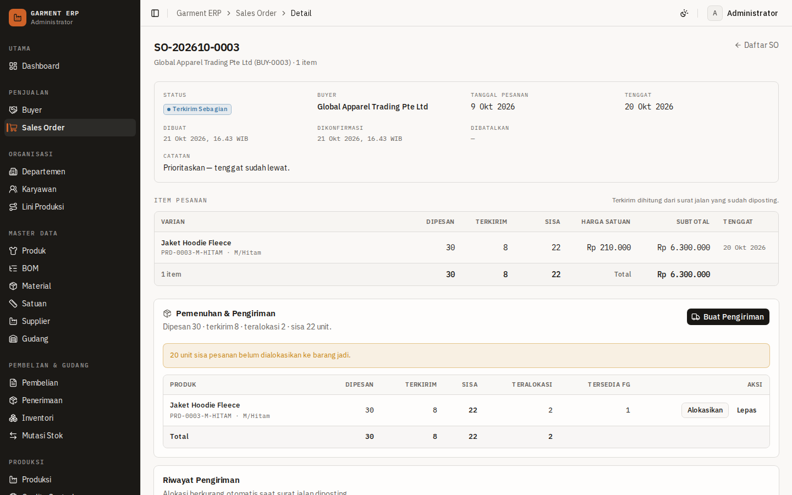
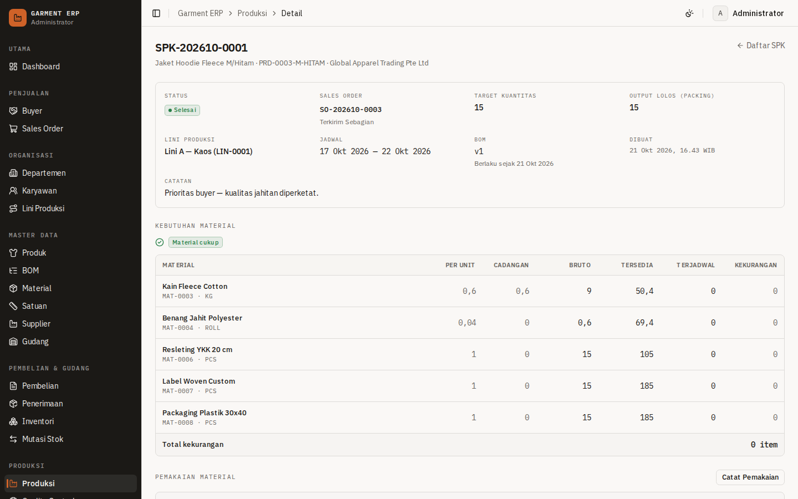
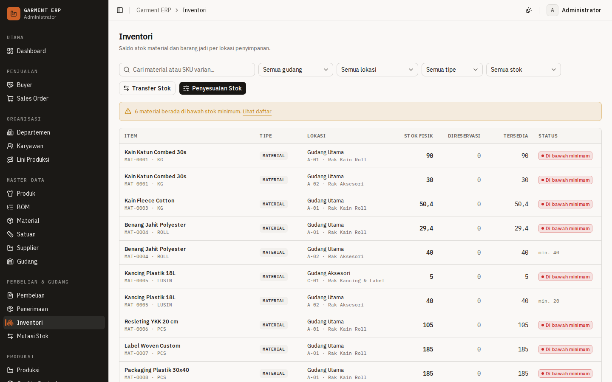
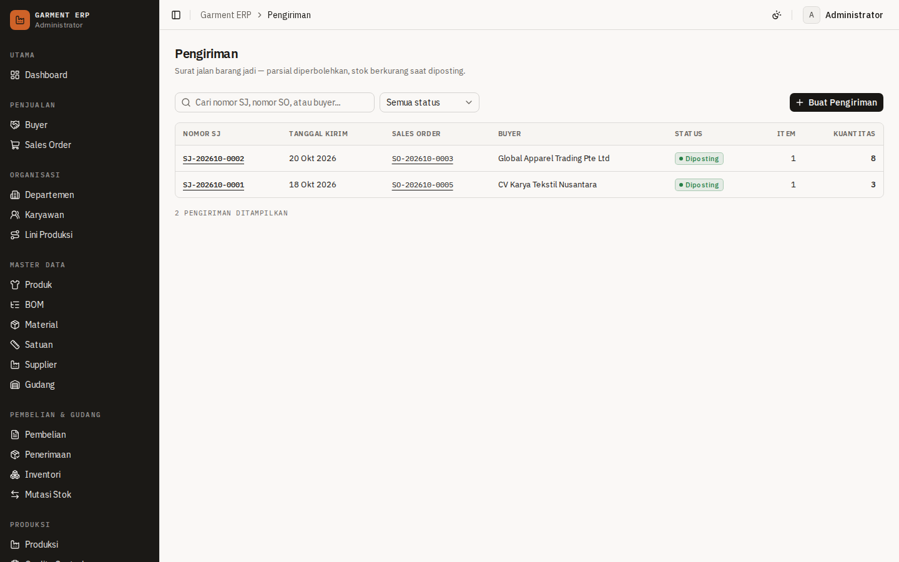
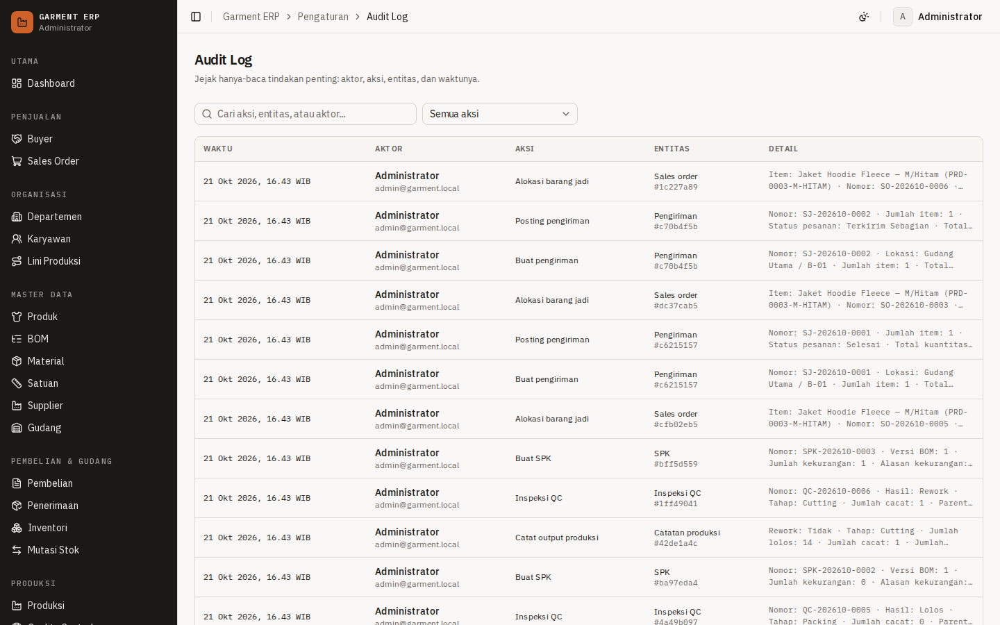

# Garment ERP System

[](https://github.com/mohimamrifai/garment-erp/actions/workflows/ci.yml)

Aplikasi web ERP (Enterprise Resource Planning) untuk industri manufaktur garmen: mengelola alur
**Sales Order → Material Planning → Purchasing → Material Receipt → Production → QC → Finished Goods → Shipment → Reporting**
dalam satu sumber data terpusat dengan kontrol akses berbasis role.

Proyek ini dibangun sebagai portofolio full-stack dengan MVP 11 modul P0. Kebutuhan lengkap ada di
[`PRD.md`](./PRD.md), rencana pengerjaan bertahap ada di [`docs/plan.md`](./docs/plan.md), dan
bukti pemenuhan acceptance criteria ada di [`docs/acceptance.md`](./docs/acceptance.md).

## Demo

🔗 **[garment-erp-olive.vercel.app](https://garment-erp-olive.vercel.app)** — masuk memakai akun demo
di bawah (mis. `admin@garment.local` / `password123`), atau klik tombol **masuk cepat** per role di
halaman login (`NEXT_PUBLIC_DEMO_MODE=1`). Deployment: Vercel region `sin1` + Neon Postgres
(Singapore), database produksi di-seed dengan data contoh yang sama seperti `pnpm db:seed`.
Skenario presentasi per role ada di [`docs/demo.md`](./docs/demo.md).

| Dashboard                                           | Sales Order & Pemenuhan                                       |
| --------------------------------------------------- | ------------------------------------------------------------- |
|      |  |

| Produksi (SPK)                                      | Inventori                                            |
| --------------------------------------------------- | ---------------------------------------------------- |
|  |  |

| Pengiriman                                          | Audit Log                                            |
| --------------------------------------------------- | ---------------------------------------------------- |
|      |       |

> Screenshot lain (login, QC, barang jadi, laporan, pengguna) ada di `docs/screenshots/` dan dapat
> diregenerasi dengan `node scripts/capture-screenshots.mjs` saat server produksi berjalan.

## Status

| Fase | Lingkup                                                  | Status     |
| ---- | -------------------------------------------------------- | ---------- |
| F1   | Fondasi: auth, RBAC, audit, master data buyer, dashboard | ✅ Selesai |
| F2   | Master data lengkap + BOM + Sales Order                  | ✅ Selesai |
| F3   | Purchasing, penerimaan material, inventory engine        | ✅ Selesai |
| F4   | Produksi (SPK), QC                                       | ✅ Selesai |
| F5   | Barang jadi, pengiriman, laporan                         | ✅ Selesai |
| F6   | Release readiness: E2E lengkap, keamanan, deploy demo    | ✅ Selesai · **v1.0** |

> F1 juga mencakup **design system "Pabrik"** (identitas visual, token, komponen) —
> dokumentasi di [`docs/design-system.md`](docs/design-system.md).
> F2 mencakup master data organisasi & produk (departemen, karyawan, lini, supplier,
> satuan, material, produk + varian, gudang + lokasi), **BOM berversi** (versi aktif
> beku — revisi lewat versi baru), dan modul **Sales Order** (draf → konfirmasi →
> pembatalan beralasan, penomoran `SO-YYYYMM-####`).
> F3 mencakup **inventory engine** (satu-satunya jalur perubahan saldo: transaksi
> immutable, idempotent, aman konkurensi), **Purchase Order**
> (`PO-YYYYMM-####`: draf → dipesan → diterima sebagian/lengkap, batal bersyarat),
> **Penerimaan Material** (`RCV-YYYYMM-####`: draf → diposting, lokasi per dokumen),
> serta operasi **transfer** (`TRX-YYYYMM-####`) dan **penyesuaian stok** beralasan.
> F4 mencakup **material planning** (rumus FR-07: bruto + cadangan − tersedia −
> penerimaan terjadwal; tombol buat PO prefill dari kekurangan), **gate ketersediaan**
> sebelum SPK (kekurangan boleh jalan hanya dengan alasan supervisor yang tercatat),
> **SPK** (`SPK-YYYYMM-####`: terbuka → berjalan → selesai, 4 tahap otomatis
> cutting/sewing/finishing/packing, BOM terkunci), **output tahap** dengan kontrol
> kuantitas antar-tahap, **pemakaian material** (`MIS-YYYYMM-####`) lewat inventory
> engine, serta **QC** (`QC-YYYYMM-####`: lolos/gagal/rework + rincian cacat) dengan
> alur **rework** ber-`parent_inspection_id` tanpa menggandakan output.
> F5 mencakup **barang jadi** (lot `finished_goods` untuk ketertelusuran SPK + inspeksi QC
> akhir; saldo tetap satu-satunya lewat inventory engine), **alokasi/reservasi** FG ke item
> SO beserta pelepasan, **surat jalan** (`SJ-YYYYMM-####`: draf → diposting, parsial,
> guard sisa pesanan & stok, posting atomik via engine), status SO **terkirim sebagian** /
> **selesai**, **dashboard penuh** (filter periode 7/30/90 hari + grafik output Recharts),
> dan **7 laporan** dengan filter periode, scoping role, serta **ekspor CSV**.
> F6 mencakup **E2E lengkap** (login tiap role, penolakan akses, order-to-shipment,
> manajemen pengguna, audit log), **uji negatif keamanan API** (401/403/404/409/422,
> IDOR, anti penggandaan), **audit otorisasi** + perbaikan temuan, **halaman Audit Log**
> hanya-baca, **seed demo lintas status** (draf, dalam produksi, siap kirim, terkirim
> sebagian, selesai, dibatalkan), **header keamanan**, README + [`docs/api.md`](docs/api.md),
> serta verifikasi acceptance PRD §12.

## Stack

| Layer     | Teknologi                                                              |
| --------- | ---------------------------------------------------------------------- |
| Framework | Next.js 16 (App Router, TypeScript strict, Cache Components)           |
| UI        | Tailwind CSS v4 + shadcn/ui (Base UI) + design system "Pabrik" (IBM Plex Sans/Mono), React Hook Form + Zod |
| Database  | PostgreSQL (Docker lokal untuk dev, Neon untuk deploy)                 |
| ORM       | Drizzle ORM + Drizzle Kit                                              |
| Auth      | Better Auth (email + password, RBAC via tabel `roles`/`user_roles`)    |
| API       | REST via Route Handlers di `/api/v1` (semua mutasi)                    |
| Testing   | Vitest (unit + integration) dan Playwright (E2E)                       |

## Menjalankan secara lokal

Prasyarat: Node.js >= 20.9, pnpm 10, Docker.

```bash
# 1. Install dependencies
pnpm install

# 2. Siapkan environment
cp .env.example .env

# 3. Nyalakan PostgreSQL (dev + test db) di localhost:5435
docker compose up -d

# 4. Migrasi & seed database
pnpm db:migrate
pnpm db:seed

# 5. Jalankan aplikasi
pnpm dev
```

Buka http://localhost:3000 — Anda akan diarahkan ke halaman masuk.

## Akun demo

Semua akun memakai password `password123` (dibuat oleh `pnpm db:seed`; dapat diganti lewat
`SEED_DEFAULT_PASSWORD`).

| Email                      | Role                |
| -------------------------- | ------------------- |
| `admin@garment.local`      | Administrator       |
| `manager@garment.local`    | Manager             |
| `sales@garment.local`      | Sales               |
| `purchasing@garment.local` | Purchasing          |
| `warehouse@garment.local`  | Gudang              |
| `produksi@garment.local`   | Supervisor Produksi |
| `qc@garment.local`         | Staff QC            |
| `shipping@garment.local`   | Staff Pengiriman    |

RBAC menerapkan satu user bisa memiliki banyak role; role `ADMIN` adalah satu-satunya yang dapat
mengelola pengguna dan melihat audit log.

Pada deployment demo (`NEXT_PUBLIC_DEMO_MODE=1`, mis. versi Vercel proyek ini) halaman login
menampilkan tombol **masuk cepat** per role — satu klik untuk masuk tanpa mengetik kredensial.
Pada deployment non-demo (variabel tidak diisi), tombol disembunyikan.

## Alur bisnis (order-to-shipment)

1. **Sales** membuat buyer → sales order (`SO-`) → konfirmasi (draf masih bisa diubah/dibatalkan).
2. **Material planning** menghitung kekurangan; **Purchasing** membuat PO (`PO-`) → *pesan* ke
   supplier → penerimaan material (`RCV-`) → *posting* menambah stok lewat inventory engine.
3. **Supervisor Produksi** membuat SPK (`SPK-`) dengan gate ketersediaan material (kekurangan
   hanya boleh jalan dengan alasan tercatat) → mencatat output tiap tahap
   (cutting → sewing → finishing → packing) → mencatat pemakaian material (`MIS-`).
4. **QC** menginspeksi tiap tahap (lolos/gagal/rework + cacat); inspeksi *packing* yang lolos
   otomatis membuat **lot barang jadi**.
5. **Gudang/Pengiriman** mengalokasikan barang jadi ke item SO → membuat surat jalan (`SJ-`) →
   *posting* (atomik: melepas alokasi, mengeluarkan stok, memperbarui status SO).
6. **Dashboard & 7 laporan** merangkum seluruh alur; **Administrator** memantau audit log.

## Skrip

| Skrip                                                      | Fungsi                                           |
| ---------------------------------------------------------- | ------------------------------------------------ |
| `pnpm dev`                                                 | Jalankan dev server (Turbopack)                  |
| `pnpm build` / `pnpm start`                                | Build & jalankan produksi                        |
| `pnpm lint` / `pnpm typecheck` / `pnpm format`             | Kualitas kode                                    |
| `pnpm typegen`                                             | Generate tipe Next (rute/layout) untuk typecheck |
| `pnpm test:unit`                                           | Tes unit (tanpa database)                        |
| `pnpm test:integration`                                    | Tes integrasi (memakai `DATABASE_URL_TEST`)      |
| `pnpm test:e2e`                                            | Playwright E2E (jalankan `pnpm build` dulu)      |
| `pnpm verify`                                              | lint + typecheck + unit + integration            |
| `pnpm db:generate` / `db:migrate` / `db:seed` / `db:reset` | Drizzle Kit & seed                               |
| `pnpm db:studio`                                           | Drizzle Studio                                   |

## Testing

Angka terakhir `pnpm verify` + `pnpm test:e2e`: **87 unit**, **62 integration**, **37 E2E** lulus.

- **Unit** — logika murni: matriks izin, format tanggal/periode dokumen Jakarta, skema Zod,
  transisi status sales order, purchase order, shipping, produksi, serta aritmetika & aturan
  inventory engine.
- **Integration** — service + PostgreSQL nyata (`garment_erp_test`, di-reset otomatis per file),
  termasuk penomoran dokumen atomik saat 10 transaksi paralel, siklus SO/PO/SPK, posting via engine
  (idempotent, anti over-receipt/over-issue), alokasi & pengiriman FG, serta backstop CHECK database
  untuk saldo.
- **E2E Playwright** — dijalankan terhadap **build produksi** (`next start`):
  - `auth.spec` — login/logout, pesan galat, masuk cepat demo, penolakan halaman admin.
  - `roles.spec` — login **8 role**: visibilitas menu sidebar + halaman yang diizinkan +
    penolakan (`/akses-ditolak`) untuk setiap role.
  - `buyer/sales-order/purchasing/production/shipping.spec` — alur vertikal penuh dari buyer
    sampai **order-to-shipment** (QC akhir → alokasi → surat jalan → posting → laporan 7 slug + CSV).
  - `users.spec` — admin membuat pengguna → menonaktifkan → akun tertolak saat login →
    mengaktifkan kembali → login; larangan menonaktifkan akun sendiri; audit log.
  - `security.spec` — uji negatif API: tanpa sesi (401), lintas role (403), kuantitas
    negatif/nol/pecahan & item kosong (422), melebihi sisa pesanan (409), ID non-UUID (404),
    item milik dokumen lain (400), posting ganda (409), idempotensi transfer.

```bash
pnpm db:migrate && pnpm db:seed   # sekali saja
pnpm build
pnpm test:e2e
```

Playwright menyalakan `next start` sendiri di port 3000 (hentikan dev server terlebih dahulu bila
sedang berjalan). Rate limit Better Auth dimatikan hanya untuk E2E lewat env
`E2E_DISABLE_RATE_LIMIT=1` yang di-set otomatis oleh konfigurasi Playwright.

## Deployment (Neon + Vercel)

- **Neon Postgres** — project `young-field-23383019`, region **Singapore (ap-southeast-1)**,
  branch `main`. Gunakan **pooled connection** (`...-pooler...`) sebagai `DATABASE_URL` runtime
  aplikasi di Vercel; gunakan **direct connection** (host `ep-...aws.neon.tech` tanpa `-pooler`)
  untuk migrasi/seed dari lokal:

  ```bash
  # dari mesin lokal, dengan connection string DIRECT dari Neon Console
  DATABASE_URL="postgresql://...@ep-....aws.neon.tech/neondb?sslmode=require" pnpm db:migrate
  DATABASE_URL="postgresql://...@ep-....aws.neon.tech/neondb?sslmode=require" pnpm db:seed
  ```

- **Vercel** — project region `sin1` (Singapore), env vars: `DATABASE_URL` (pooled),
  `BETTER_AUTH_SECRET`, `BETTER_AUTH_URL` (URL publik deployment), `NEXT_PUBLIC_DEMO_MODE=1`
  untuk demo. Deploy produksi: `vercel deploy --prod --yes` (push ke GitHub tidak otomatis
  men-deploy).
- Runtime aplikasi hanya butuh **pooled** URL; migrasi DDL lebih aman lewat **direct** URL.

## Batasan paket gratis (Vercel + Neon)

- **Neon scale-to-zero**: setelah idle, permintaan pertama bisa memakan 5–10 detik (cold start
  database). Buka halaman beberapa menit sebelum presentasi.
- **Vercel Hobby**: serverless function timeout pendek dan bandwidth terbatas — cukup untuk demo,
  bukan trafik produksi nyata.
- Satu region (Singapore) saja; tidak ada read replica/HA.
- Akun demo & `NEXT_PUBLIC_DEMO_MODE` bersifat publik pada deployment ini. Untuk data nyata:
  jangan aktifkan demo mode dan ganti password seed.
- Rincian lengkap ada di bagian "Deployment & Cost Constraints" pada [`PRD.md`](./PRD.md).

## Struktur

```text
src/
  app/
    (auth)/            # halaman masuk
    (dashboard)/       # shell dashboard: sidebar per role, header, breadcrumb
      settings/        # pengguna + audit log (khusus Administrator)
    api/v1/            # REST mutasi (route handler tipis: auth → Zod → service)
  components/
    ui/                # shadcn/ui (Base UI + preset base-nova)
    layout/            # sidebar, header, breadcrumb, pagination
  modules/             # modul bisnis: schemas + service (dipecah bila besar) + components
    buyer/  user/      # F1: master data buyer & manajemen pengguna
    audit/             # F6: penampil audit log (hanya-baca)
    master/            # F2: organisasi, supplier, satuan, material, produk, gudang, BOM
    sales-order/       # F2: sales order + status & transisinya
    purchasing/        # F3: purchase order, penerimaan material
    inventory/         # F3: inventory engine, saldo, mutasi, transfer, penyesuaian
    production/        # F4: SPK, material planning, output tahap, pemakaian material
    qc/                # F4: inspeksi per tahap, rincian cacat, rework
    finished-goods/    # F5: lot & saldo barang jadi
    shipping/          # F5: alokasi, surat jalan, pemenuhan SO
    reports/           # F5: 7 laporan + ekspor CSV
    dashboard/         # F5: agregasi periode & grafik output
  lib/
    auth/              # konfigurasi Better Auth, DAL sesi, guard API
    db/                # koneksi Drizzle + schema + seed
    api/               # ApiError, format respons { data, meta } / { error }
    utils/             # tanggal (Asia/Jakarta), mata uang, penomoran dokumen
  proxy.ts             # pemeriksaan cookie optimistis (pengganti middleware)
tests/
  unit/ integration/ e2e/
drizzle/               # migrasi SQL
docs/                  # plan, design system, API, demo, keamanan, acceptance, backlog
scripts/               # seed, reset, screenshot
```

## Dokumentasi

| Dokumen                                          | Isi                                                       |
| ------------------------------------------------ | --------------------------------------------------------- |
| [`docs/plan.md`](docs/plan.md)                   | Rencana bertahap F1–F6 + catatan penyelesaian              |
| [`docs/design-system.md`](docs/design-system.md) | Token warna, tipografi, komponen, aturan visual            |
| [`docs/api.md`](docs/api.md)                     | Referensi REST `/api/v1`: endpoint, izin, contoh request   |
| [`docs/demo.md`](docs/demo.md)                   | Skenario demo 10 menit + peran tiap role                   |
| [`docs/security-review.md`](docs/security-review.md) | Audit otorisasi & review keamanan (F6.3–F6.4)          |
| [`docs/acceptance.md`](docs/acceptance.md)       | Bukti pemenuhan acceptance criteria PRD §12                |
| [`docs/backlog.md`](docs/backlog.md)             | Kandidat pengembangan pasca-MVP                            |

## Konvensi penting

- **Mutasi** data lewat REST `/api/v1` (route handler tipis), **pembacaan** langsung via service
  layer dari Server Component.
- Respons API: sukses `{ data, meta? }`; error `{ error: { code, message, details? } }`.
- Cache Components aktif: pembacaan runtime (DB, cookie, header) dibungkus `<Suspense>`;
  halaman memakai pola Partial Prerender (shell statis + bagian dinamis mengalir).
- Setiap mutasi multi-tabel berada dalam satu transaksi database bersama baris audit log
  (`recordAudit(tx, ...)`).
- Penomoran dokumen atomik via tabel `document_sequences`
  (`SO-/PO-/RCV-/SPK-/MIS-/QC-/SJ-YYYYMM-####` mengikuti kalender Asia/Jakarta; buyer memakai counter
  global `BUY-0001`).
- Semua perubahan saldo stok **wajib** melalui inventory engine (`src/modules/inventory/engine.ts`):
  transaksi immutable + saldo diperbarui dalam satu transaksi DB, dengan kunci idempotensi
  untuk endpoint posting.
- Bahasa visual mengikuti `docs/design-system.md`: token di `src/app/globals.css` (jangan
  menulis warna literal), angka/kode selalu `font-mono` + tabular, satu aksen oranye untuk
  fokus/nav aktif, sidebar selalu graphite gelap di kedua mode tema.

## English summary

A garment-manufacturing ERP MVP built with Next.js 16 (App Router), PostgreSQL + Drizzle ORM,
and Better Auth, covering the full order-to-shipment flow: sales orders, material planning and
purchasing, warehouse receipts through a single-threaded inventory engine (immutable, idempotent
transactions), production work orders with stage outputs, QC with rework, finished-goods lots and
reservations, shipments with CSV reporting, role-based access control for 8 roles, and a read-only
audit log. Quality gates: 87 unit, 62 integration, and 37 Playwright E2E tests against the
production build, plus API security negative tests (401/403/404/409/422, IDOR, idempotent double
submit). Deployed as a demo on Vercel + Neon (Singapore) with a seeded, realistic dataset.

---

Dibangun sebagai proyek portofolio full-stack — silakan hubungi pemilik repo untuk pertanyaan.
